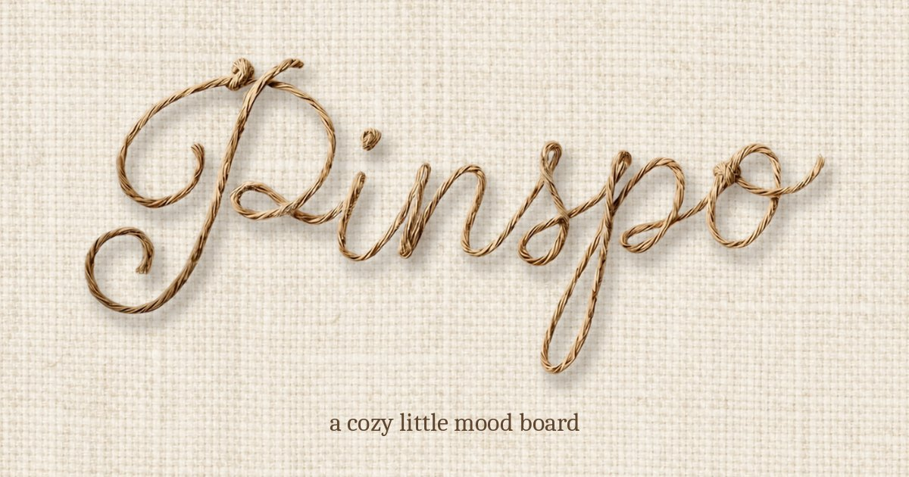

# Pinspo

A cozy, interactive mood board. Pin pictures, notes and little treasures to your own cork board.

**Live site: [pinspo.org](https://pinspo.org)**

## What you can do

- **Pick things off the shelf** and add them to the board: stickers, paper, sticky notes, push pins, polaroid frames and more.
- **Move, resize, rotate and delete** anything on the board. Push pins can be flipped.
- **Write notes.** The pencil jar opens a little ticket where you pick a font and a color.
- **Add a date.** The desk calendar asks for a date and pins it to the board.
- **Add your own pictures** with the upload button.
- **Edit the board** by lighting the candle: see every item in its layer, reorder them, or clear the whole board.
- **Save as a picture** with the save button.
- **Come back later.** The board is remembered automatically in your browser.
- **Works on phones** with its own layout and touch controls.

## Privacy

Pinspo has no accounts, no server and no database. Your board and photos are stored only in your own browser (localStorage) and are never uploaded anywhere. Clearing your browser's site data erases the saved board, so use **Save as picture** to keep one.

## How it's built

A plain static site with no build step: HTML, CSS and JavaScript.

| File | What it does |
| --- | --- |
| `index.html`, `style.css`, `script.js` | The desktop site |
| `phone.html`, `phone.css`, `phone.js` | The phone layout (small screens are sent here from `index.html`) |
| `images/` | Artwork, animation frames, favicon and share image |
| `CNAME` | Tells GitHub Pages to serve the site at pinspo.org |

Sounds are generated in code with the Web Audio API, so there are no audio files. Saving as a picture uses [html2canvas](https://html2canvas.hertzen.com/).

## Run it on your computer

1. Download or clone this repository.
2. Open the folder in VS Code and start it with the **Live Server** extension, or run any simple local web server in the folder.
3. Open the address it shows in your browser.

## Publishing

The site is hosted with GitHub Pages from the `main` branch. Pushing a change to `main` updates the live site within a minute or two.

## Credits and rights

Artwork, logo and design are the project owner's. All rights reserved unless stated otherwise.
